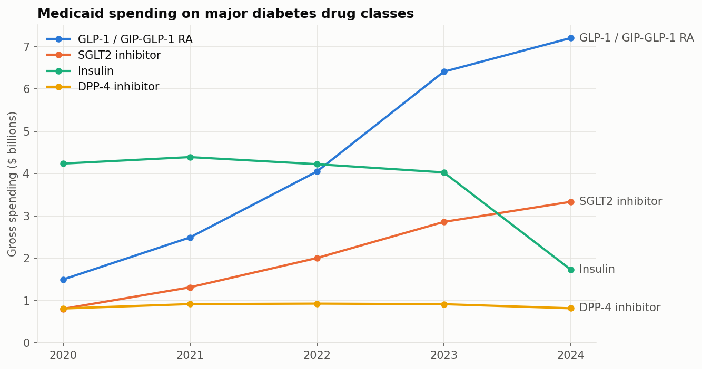
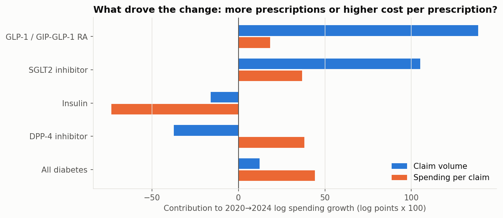

# Medicaid Spending on Diabetes Medicines, 2020–2024

How Medicaid's spending on diabetes medicines changed over five years, which drug classes drove it, whether the growth came from more prescriptions or costlier ones, and whether simple models (including Prophet) can forecast it.

All results come from the official CMS *Medicaid Spending by Drug* file (data year 2024 release) and are reproduced by one notebook: [`notebooks/medicaid_diabetes_spending.ipynb`](notebooks/medicaid_diabetes_spending.ipynb).



## Key results

Gross spending before rebates; obesity-labeled incretins (Wegovy, Zepbound, Saxenda) excluded from diabetes totals.

| | 2020 | 2024 | CAGR |
|---|---|---|---|
| All diabetes medicines | $7.78bn | $13.70bn | 15.2% |
| GLP-1 / GIP-GLP-1 receptor agonists | $1.50bn | $7.21bn | 48.1% |
| SGLT2 inhibitors | $0.81bn | $3.34bn | 42.6% |
| Insulin | $4.24bn | $1.73bn | −20.0% |
| Obesity-labeled incretins (excluded) | $0.01bn | $1.56bn | n/a |

- **GLP-1 receptor agonists rose from 19% to 53% of diabetes-medicine spending.** Most of the class's growth came from more claims rather than higher spending per claim.
- **Diabetes spending peaked in 2023 ($14.82bn) and fell in 2024.** The cause was insulin: gross spending fell 57% while claims fell 10.5%, consistent with the 2024 insulin list-price changes.
- Across all classes, most growth came from higher *spending per claim*. That reflects a shift toward branded incretins, not price increases on the same products.



## Forecasting: an honest negative result

Each model was fit on 2020–2022 and scored on held-out 2023–2024 values:

| Model | Mean MAPE across 5 series | MAPE, all-diabetes total |
|---|---|---|
| Drift | **24.3%** | 10.9% |
| Linear trend | 25.5% | 10.9% |
| Prophet (linear, no seasonality) | 25.6% | 10.9% |
| Naive (last value) | 34.9% | 17.8% |

With annual data, Prophet has no seasonality to model and too few points for changepoints, so it reduces to a straight line and adds nothing over simple baselines. No model anticipated the 2024 insulin repricing. The notebook's 2025–2026 numbers are therefore presented as **illustrative trend scenarios, not forecasts**.

**Uncertainty intervals are not shown.** In the same backtest, Prophet's 80% interval contained **0 of the 10** held-out values (5 series × 2 years). With no changepoints, Prophet's interval reflects only the scatter of three points around a straight line, not real forecast error, and five annual observations are too few to validate an interval from any method. The projection table and figure therefore show point projections only.

## Methods

1. Verify the raw file against its SHA-256 checksum. Keep the national `Overall` rows only.
2. Classify products into therapeutic classes from the generic name (`src/diabetes_spending.py`, unit-tested). Obesity-labeled brands are separated out.
3. Reshape wide year columns to long format and aggregate by class and year.
4. Decompose log spending growth exactly into a claim-volume part and a spending-per-claim part.
5. Backtest naive, drift, linear-trend and Prophet models, then project 2025–2026.

## Limitations

- **Gross, pre-rebate spending.** Medicaid rebates are large for brand-name drugs; net cost and its trend aren't observable here.
- **No indication data.** SGLT2 inhibitors are also used for heart failure and kidney disease.
- **Five annual points.** That's too few to validate a forecasting model or to estimate a trustworthy prediction interval. The backtest has only two held-out years per series, and its 10 held-out values aren't independent.
- **National aggregates only.** There's no link to clinical outcomes.

## Reproduce

```bash
python -m venv .venv
.venv\Scripts\activate            # macOS/Linux: source .venv/bin/activate
pip install -r requirements.txt
python scripts/download_data.py   # verifies the committed CMS file (re-downloads if missing)
pytest
jupyter nbconvert --to notebook --execute --inplace notebooks/medicaid_diabetes_spending.ipynb
```

Tested with Python 3.13.

## Repository layout

```
data/raw/        CMS source file (public domain) + data/README.md provenance
notebooks/       analysis notebook (executed, outputs included)
reports/figures/ figures written by the notebook
scripts/         data download and checksum verification
src/             drug classification, reshaping, decomposition, forecast baselines
tests/           pytest suite (classification rules, transforms, data checksum)
```

## Changes from the earlier version

The previous notebook (`Medicaid.ipynb`) loaded the CMS file but ran its trend analysis and Prophet forecasts on **hand-typed placeholder numbers**, and its README described SARIMAX and regression models that weren't implemented. This version replaces it entirely. Every reported figure is computed from CMS data.

## Author

Prince Kwarteng Amaning. MS Data Science, University of Michigan–Dearborn. Background in dentistry and public health.

License: MIT (code). The CMS data is a U.S. government work.
